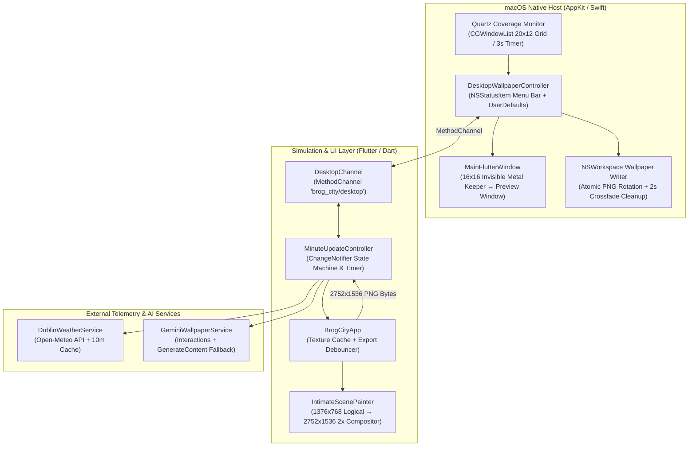

# Specification: Brog City

## 1. Overview & System Goals

**Brog City** is an ambient macOS desktop wallpaper engine and menu bar utility that transforms the desktop background across all connected displays into a living, tightly zoomed-in 2.5D isometric pixel-art diorama. Rather than rendering sprawling, distant city skylines or running a GPU-draining 60 FPS video loop behind application windows, Brog City focuses on **intimate, two-building waterfront corners** updated at a calm, configurable cadence (at most once per minute).

### Problem Statement & Core Philosophy
1. **Intimate Architectural Scale over Distant Skylines**: Every scene frames only two adjacent buildings, their connecting alleyway or canal bridge, and the adjoining water at street level (`1376 × 768` base pixel grid, exported at `2752 × 1536` `2×` integer scale).
2. **Real-World Telemetry Grounding**: Scenes respond automatically to real-time meteorological conditions in **Dublin, Ohio (`40.0992° N, -83.1141° W`)** via the keyless Open-Meteo API and synchronize their ambient lighting and analog clock hands with the host's local system clock.
3. **Hybrid Generative AI + Deterministic Pixel Compositing**: When configured with a Google Gemini API key, each update synthesizes a brand-new 32-bit HD isometric pixel-art scene tailored to the active architectural archetype, live Dublin weather, time of day, and ambient micro-activities. When offline or running without an API key, the engine seamlessly renders five bundled high-definition pixel-art archetypes enhanced with procedural, pixel-aligned animations (working analog clocktower and tram-stop hands, pulsing lantern halos, rising tea/coffee/chimney steam, hearth flames, drifting autumn leaves, swimming fish, and multi-layer weather particles).
4. **Zero-Waste Resource Discipline**: The application runs as a background macOS Menu Bar accessory (`NSStatusItem`) that monitors window coverage across all connected monitors via Quartz Window Services (`CGWindowListCopyWindowInfo`), automatically pausing updates whenever all displays are covered (`≥ 88%` occluded) or asleep, and catching up immediately when uncovered.

### Reference Stack & Implementation Portability
- **Reference Implementation**: Built with **Flutter (`^3.13.5`)** for cross-platform 2D canvas compositing (`CustomPainter` + `PictureRecorder`) paired with a native **Swift / AppKit (`MainFlutterWindow.swift` & `DesktopWallpaperController`)** host layer for `NSWorkspace` multi-display wallpaper assignment, `NSStatusBar` menu management, and `CoreGraphics` window occlusion sampling.
- **Stack Agnosticism**: An autonomous coding agent may implement this specification in **Flutter + Swift (macOS)**, **Swift + CoreGraphics/Metal**, **Tauri (Rust + HTML5 Canvas)**, or **Electron**. All functional state machines, coordinate tables, IPC contracts, and external API payloads are specified deterministically in this document and its linked domain sub-specifications:
  - [Domain Data Models, Enumerations & Scene Geometry (`./domain/schema.md`)](./domain/schema.md)
  - [External APIs & Native Bridge Contracts (`./domain/api.md`)](./domain/api.md)
  - [Pixel-Art Compositor & Multi-Display Occlusion Engine (`./domain/rendering-and-occlusion.md`)](./domain/rendering-and-occlusion.md)

---

## 2. Core Workflows & User Stories

### Workflow 1: Headless Launch, State Hydration & Initial Wallpaper Export
1. On application launch, the native host initializes the main window in **hidden background mode** (`NSApp.setActivationPolicy(.accessory)`, shrunk to an invisible, click-through `16 × 16` desktop-level surface so the GPU rasterizer stays warm without appearing in the Dock or Command-Tab switcher) and installs the system Menu Bar item (`building.2.crop.circle.fill` template icon or `🏙️` fallback).
2. The UI runtime preloads the 5 bundled scene PNG assets ([`scene_04`](./assets/scene_04_twilight_tram_bistro.png), [`scene_07`](./assets/scene_07_clocktower_flower_shop.png), [`scene_08`](./assets/scene_08_rainy_brick_arch.png), [`scene_09`](./assets/scene_09_boathouse_rooftop_garden.png), [`scene_10`](./assets/scene_10_winter_canal_bakery.png)) into GPU textures and invokes `getInitialState` over the native bridge (`brog_city/desktop`).
3. The native host reads persisted preferences from `UserDefaults`, evaluates current multi-display window occlusion, resolves any stored or environment `GEMINI_API_KEY`, and returns a `NativeDesktopInitialState` payload.
4. If `weatherOverride == 'dublin_live'`, the controller queries Open-Meteo for live Dublin, Ohio weather (`DublinWeatherService.fetchDublinWeather`) and caches the resulting `DublinWeatherSnapshot`.
5. The compositor immediately renders Update `#1` (`lastTriggerReason = 'INITIAL LAUNCH'`) at `2752 × 1536` resolution and sends the PNG bytes to `applyWallpaperPng`, setting the desktop wallpaper across all connected monitors.
6. If a valid Gemini API key is present, the controller asynchronously dispatches a live AI scene generation request; once the returned base64 image decodes, the compositor re-exports and applies the AI-generated wallpaper.

### Workflow 2: Scheduled Minute-by-Minute Update Cycle & Daily Scene Rotation
1. While not paused and while `intervalMinutes > 0` (`1`, `15`, or `60`), `MinuteUpdateController` schedules a single-shot timer for `Duration(minutes: intervalMinutes)` and sets `nextScheduledUpdateTime = now + duration`.
2. When the timer fires:
   - `updateCount` increments by `1`.
   - `lastUpdateTime` updates to `clock()`.
   - `lastTriggerReason` becomes `'${intervalMinutes}M TIMER CYCLE'` (e.g., `'1M TIMER CYCLE'`).
   - If `sceneSelection == 'daily_auto'`, `activeScene` is evaluated via `CityScene.forDate(lastUpdateTime)`, rotating deterministically through all 5 scenes across any 5 consecutive UTC calendar days.
3. The compositor immediately paints the updated minute state (advancing analog clock hands, re-seeding procedural steam/particles/ripples with `updateCount`) and exports the new wallpaper PNG.
4. Concurrently, the controller refreshes the Dublin weather snapshot (using a 10-minute TTL cache) and triggers a new Gemini scene generation if an API key is configured.

### Workflow 3: Automatic Multi-Display Occlusion Pause & Uncover Catch-Up
1. Every `3.0 seconds` (and immediately upon workspace app activation, active Space change, display reconfiguration, or screen sleep/wake notifications), the native host samples window coverage across each connected `NSScreen` using a `20 × 12` point grid (`240` samples per screen) against on-screen application windows (`kCGWindowLayer == 0`, `alpha >= 0.15`, excluding the app's own PID).
2. If all connected displays are `>= 88%` covered (or if displays are asleep), the native host notifies the controller with `onVisibilityChanged(visible: false, coveragePercent: minCoverage, reason: ...)`.
3. The controller cancels its active timer (`nextScheduledUpdateTime = null`) and halts background updates (`isEffectivelyPaused == true`).
4. When the user minimizes or closes covering windows—or switches to an uncovered macOS Space—such that at least one display drops below `88%` coverage (`visible: true`):
   - The controller compares `elapsed = now - lastUpdateTime` against `Duration(minutes: intervalMinutes)`.
   - **Catch-Up**: If `elapsed >= interval`, it immediately executes an update (`lastTriggerReason = 'UNCOVER CATCH-UP'`) and schedules a fresh full interval timer.
   - **Resume Remainder**: If `elapsed < interval`, it schedules a timer for the remaining duration (`interval - elapsed`) without prematurely incrementing the frame counter.

### Workflow 4: Menu Bar Customization & Live Gemini API Key Configuration
1. From the macOS Menu Bar icon, the user can:
   - **Update Wallpaper Now (`⌘R`)**: Forces an immediate update (`MANUAL MENU TRIGGER`).
   - **Cycle to Next Scene (`⌘N`)**: Steps `activeScene` to the next enum variant (`(index + 1) % 5`), pins `sceneSelection` to that scene's ID, and updates the Menu Bar checkmarks.
   - **Select Scene / Weather / Lighting / Interval**: Picks a specific scene (`daily_auto` or `scene_04..scene_10`), weather mode (`dublin_live`, `scene_default`, `clear`, `rain`, `snow`, `mist`), lighting tint (`clock_sync`, `original`, `dawn`, `daylight`, `sunset`, `night`), or refresh cadence (`1`, `15`, `60`, or `0` for Never).
   - **Stamp Diagnostic Badge on Wallpaper**: Toggles the top-left telemetry HUD badge (`HUD TOGGLED`) and immediately re-exports the current base image **without** burning a new Gemini API request (`regenerateWithGemini: false`).
   - **Set Gemini API Key… (`⌘K`)**: Opens a native `NSAlert` modal with an `NSTextField` pre-populated with any existing key. Clicking **Save & Generate Now** persists the key to `UserDefaults` (`brog_city_gemini_api_key`) and immediately triggers live AI wallpaper synthesis (`API KEY CONFIGURED`).

### Workflow 5: Interactive Preview Window Mode
1. Selecting **Show Preview Window (`⌘W`)** from the Menu Bar promotes the app to `NSApplication.ActivationPolicy.regular`, restores standard window chrome (`"Brog City — Preview Window"`), and notifies the UI controller (`isDesktopWallpaperMode = false`).
2. In Preview Window mode, the UI overlays a translucent bottom-right floating control pill displaying the active scene title, live Dublin weather & Gemini status string, a **Next Scene** button, and an **Update Wallpaper Now** button.
3. Closing the Preview Window via its red close button (`windowShouldClose`) intercepts termination, hides the window back to the invisible `16 × 16` desktop keeper surface, returns the app to `.accessory` mode, and keeps the background wallpaper engine running.

---

## 3. Architecture & Component Decomposition

### Subsystem Responsibilities
1. **Simulation Controller (`MinuteUpdateController`)**: Single source of truth for timer scheduling, pause/occlusion catch-up calculations, daily scene selection, weather override resolution, request token cancellation (`_activeRequestToken`) for in-flight Gemini calls, and native status synchronization.
2. **Offscreen & Live Compositor (`BrogCityApp` + `IntimateScenePainter`)**: Manages `ui.Image` lifecycle for the 5 bundled scene bitmaps and the latest decoded Gemini bitmap; deduplicates export requests using a 6-tuple state signature (`updateCount`, `scene`, `geminiGenId`, `weather`, `lighting`, `hud`) plus an `_isExportingWallpaper` / `_pendingWallpaperExport` mutex queue; rasterizes the `1376 × 768` logical scene into a `2752 × 1536` PNG buffer.
3. **Meteorological Service (`DublinWeatherService`)**: Queries Open-Meteo for Dublin, Ohio (`40.0992, -83.1141`), maps WMO weather codes to `WeatherEffect`, caches snapshots for 10 minutes, and formats both compact Menu Bar strings and rich natural-language prompt clauses.
4. **Generative AI Service (`GeminiWallpaperService`)**: Resolves API keys across 4 configuration tiers, constructs deterministic 2-building isometric pixel-art prompts, executes a 4-model fallback chain (`gemini-nano-banana-2.1` → `gemini-2.5-flash-image` → `gemini-3.1-flash-image-preview` → `gemini-2.0-flash-preview-image-generation`), and extracts base64 image bytes across 5 response JSON schemas.
5. **Native Desktop Controller (`DesktopWallpaperController` & `MainFlutterWindow`)**: Owns the macOS status bar menu, `UserDefaults` persistence, multi-display Quartz occlusion sampling, Space/wake event listeners, and atomic multi-screen wallpaper file application.

For deep architectural specifications of the compositor, procedural drawing routines, and Quartz occlusion math, see [./domain/rendering-and-occlusion.md](./domain/rendering-and-occlusion.md).

---

## 4. Data Models & Entity Schemas

All data models, enumerations, WMO code mappings, lighting tint tables, and scene-specific pixel coordinate tables are specified in full in **[`./domain/schema.md`](./domain/schema.md)**. Key highlights:

- **`CityScene`**: 5 enum variants (`twilightTramBistro`, `clocktowerFlowerShop`, `rainyJazzBookbinder`, `sunlitBoathousePergola`, `winterCanalBakery`) with deterministic UTC date rotation (`CityScene.forDate`) anchored at epoch `2026-01-01 UTC`.
- **`WeatherEffect`**: `clear`, `rain`, `snow`, `mist`.
- **`LightingMode`**: `clockSync` (`clock_sync`), `original`, `dawn`, `daylight`, `sunset`, `night`.
- **`DublinWeatherSnapshot`**: Immutable telemetry record with `temperatureFahrenheit`, `weatherCode`, `conditionLabel`, `mappedEffect`, `cloudCoverPercent`, `windSpeedMph`, `isDay`, and `fetchedAt`.
- **IPC & External API Schemas**: Full request/response JSON payloads and RPC signatures are documented in **[`./domain/api.md`](./domain/api.md)**.

---

## 5. Interface & User Experience Requirements

### 5.1 Visual Reference Assets
The 5 bundled 2.5D isometric pixel-art scenes (`1376 × 768`) serve as both the offline/fallback artwork and the stylistic ground truth for AI generation:
- **Hero / Scene #4 (`twilightTramBistro`)**: [./assets/screenshot.png](./assets/screenshot.png) ([`scene_04_twilight_tram_bistro.png`](./assets/scene_04_twilight_tram_bistro.png)) — Corner French bistro with red paper lanterns and outdoor tables beside a vintage tram shelter with a live working station clock at `(914, 484)`.
- **Scene #7 (`clocktowerFlowerShop`)**: [`./assets/scene_07_clocktower_flower_shop.png`](./assets/scene_07_clocktower_flower_shop.png) — Ivy-draped brick clocktower florist with live working clock hands at `(515, 191)` beside a canal tea house deck with a steaming teapot at `(968, 692)`.
- **Scene #8 (`rainyJazzBookbinder`)**: [`./assets/scene_08_rainy_brick_arch.png`](./assets/scene_08_rainy_brick_arch.png) — Sunken basement jazz cafe with glowing neon saxophone sign next to a bookbinder beneath a stone railway viaduct arch.
- **Scene #9 (`sunlitBoathousePergola`)**: [`./assets/scene_09_boathouse_rooftop_garden.png`](./assets/scene_09_boathouse_rooftop_garden.png) — Weathered timber boathouse over turquoise harbor water paired with a Mediterranean rooftop pergola and smoking terracotta chimney at `(822, 68)`.
- **Scene #10 (`winterCanalBakery`)**: [`./assets/scene_10_winter_canal_bakery.png`](./assets/scene_10_winter_canal_bakery.png) — Glass-roofed herbalist apothecary linked by a lantern-lit stone canal bridge to a hearth bakery with flickering stone oven flames at `(1276, 635)` and chimney smoke at `(1242, 134)`.

### 5.2 macOS Menu Bar Structure (`NSStatusItem`)
The status bar menu must expose the exact hierarchy and keyboard shortcuts below:
1. **Update Wallpaper Now (Generate Fresh Scene)** (`⌘R`)
2. **Cycle to Next Scene** (`⌘N`)
3. **Set Gemini API Key…** (`⌘K`)
4. *Separator*
5. **Scene Selection** *(Submenu)*:
   - `Rotate Daily (Scene of the Day)` (`daily_auto`, default)
   - *Separator*
   - `1. Twilight Tram Stop & Corner Bistro (#4)` (`scene_04`)
   - `2. Brick Clocktower Florist & Tea House (#7)` (`scene_07`)
   - `3. Rainy Jazz Cafe & Bookbinder Viaduct (#8)` (`scene_08`)
   - `4. Sunlit Boathouse & Rooftop Pergola (#9)` (`scene_09`)
   - `5. Winter Canal Apothecary & Bakery (#10)` (`scene_10`)
6. **Weather & Atmosphere** *(Submenu)*:
   - `Live Dublin, OH Weather (Default)` (`dublin_live`, default)
   - `Scene Default Atmosphere` (`scene_default`)
   - *Separator*
   - `Clear & Fireflies / Sunbeams` (`clear`)
   - `Gentle Rain & Ripples` (`rain`)
   - `Cozy Snowfall` (`snow`)
   - `Harbor Mist` (`mist`)
7. **Time & Lighting Tint** *(Submenu)*:
   - `Sync Subtle Tint with Mac Clock (Default)` (`clock_sync`, default)
   - `Original Scene Palette (No Tint)` (`original`)
   - `Dawn Rose Glow` (`dawn`)
   - `Bright Daylight` (`daylight`)
   - `Golden Hour Sunset` (`sunset`)
   - `Deep Midnight Glow` (`night`)
8. **Update Interval** *(Submenu)*:
   - `Every 1 Minute (Default)` (`1`)
   - `Every 15 Minutes` (`15`)
   - `Every 60 Minutes` (`60`)
   - *Separator*
   - `Never (Manual Only)` (`0`)
9. *Separator*
10. **Show Preview Window** / **Hide Preview Window** (`⌘W`)
11. **Auto-Pause When All Displays Covered** *(Checkmark toggle, default `on`)*
12. **Stamp Diagnostic Badge on Wallpaper** *(Checkmark toggle, default `off`)*
13. *Separator*
14. **Quit Brog City** (`⌘Q`)

### 5.3 Interactive Preview Window Control Bar
When `isDesktopWallpaperMode == false` (Preview Window visible), a floating control card is anchored at `bottom: 20, right: 20` inside the window:
- **Container Styling**: Background `0xCC0F172A`, border radius `12px`, `1px` border `Colors.white24`, padding `12px` horizontal / `8px` vertical.
- **Left Column**:
  - Active scene title (`12pt`, `FontWeight.w600`, `Colors.white`).
  - Live status subtitle (`10pt`, `0xFF94A3B8`, displaying `controller.geminiStatus`).
- **Right Action Buttons**:
  - `OutlinedButton.icon` with `skip_next` icon (`16px`) and label `"Next Scene"` → invokes `controller.cycleNextScene`.
  - `FilledButton.icon` with `refresh` icon (`16px`) and label `"Update Wallpaper Now"` → invokes `controller.triggerManualUpdate`.

---

## 6. Edge Cases & Failure Modes

1. **Stale / Overlapping Gemini Requests (`_activeRequestToken`)**:
   - If a user rapidly clicks **Next Scene** or **Update Wallpaper Now** while a Gemini HTTP request is already in flight, incrementing `_activeRequestToken` invalidates the older request. When the superseded request resolves or throws, `token != _activeRequestToken` causes it to be silently discarded so an out-of-order image never overwrites the current scene.
2. **Concurrent Offscreen PNG Exports (`_isExportingWallpaper` & `_pendingWallpaperExport`)**:
   - Encoding a `2752 × 1536` PNG is asynchronous. If a state transition occurs while `_isExportingWallpaper == true`, the app sets `_pendingWallpaperExport = true` and immediately runs a follow-up export pass in the `finally` block once the active export finishes.
3. **Scene Mismatch on Decoded AI Image**:
   - `_resolveActiveImage(scene)` checks `_liveGeminiImage != null && _liveGeminiScene == scene`. If the user switches to a different scene before the new Gemini image finishes generating, the compositor immediately displays the new scene's bundled archetype image rather than showing the previous scene's AI image.
4. **Gemini API Failures or Missing API Key**:
   - If all 4 Gemini endpoints fail or time out (45s), `_isGeneratingGemini` resets to `false`, `_geminiStatus` updates to `"<DublinPrefix>Gemini AI: Fallback (<40-char truncated error>)"`, and the compositor continues rendering the bundled pixel-art archetype with procedural animations and live weather overlays.
5. **Corrupt Image Payload Decoding**:
   - If `ui.instantiateImageCodec` fails on returned Gemini bytes, `_decodeLatestGeminiImage` catches the exception, marks `_decodedGeminiGenerationId = targetGenId` to prevent infinite decode loops, and retains the fallback image.
6. **Open-Meteo Outage or Offline Launch**:
   - Network errors, timeouts (10s), or non-2xx responses in `DublinWeatherService` return `_cachedSnapshot` (if available) or `null`. When `null`, `activeWeather` gracefully falls back to `activeScene.defaultWeather`.
7. **macOS `WallpaperAgent` Caching & Cross-Fade Race Condition**:
   - Writing to a static file path causes macOS to ignore updates. Every export writes to `brog_city_wallpaper_<updateCount>_<timestamp>.png`. To prevent visual flicker during macOS's native desktop cross-fade transition, the immediately preceding wallpaper file (`previousURL`) is kept on disk for `2.0 seconds` before cleanup.
8. **Headless Widget Test Execution**:
   - Missing platform channels (`MissingPluginException`, `PlatformException`) and missing asset decoding in unit tests are caught and ignored so simulation logic can be deterministically verified with fake clocks.

---

## 7. Acceptance Criteria & Definition of Done

An implementation of **Brog City** is complete when all of the following observable behaviors are verified:

- [ ] **Initial State & Cadence**: Launching the controller initializes `updateCount = 1`, `sceneSelection = 'daily_auto'`, `weatherOverride = 'dublin_live'`, `lightingMode = LightingMode.clockSync`, and `intervalMinutes = 1`.
- [ ] **Strict 1-Minute Timer Boundary**: Advancing the clock by `59 seconds` leaves `updateCount == 1`; advancing by `1 additional second` (`60s` total) increments `updateCount` to `2` with `lastTriggerReason == '1M TIMER CYCLE'`.
- [ ] **Deterministic 5-Day Scene Rotation**: Calling `CityScene.forDate` across any 5 consecutive calendar days produces all 5 distinct `CityScene` enum values (`scene_04`, `scene_07`, `scene_08`, `scene_09`, `scene_10`).
- [ ] **Scene Cycling Sync**: Invoking `cycleNextScene()` advances `activeScene` to the next enum entry, sets `sceneSelection` to `activeScene.id`, increments `updateCount` with reason `'SCENE CYCLED'`, and synchronizes the selection back to the native Menu Bar.
- [ ] **Refresh Interval Modes**: Setting `intervalMinutes` to `15` or `60` schedules `nextScheduledUpdateTime` accordingly; setting `intervalMinutes` to `0` (`isNeverRefresh == true`) sets `nextScheduledUpdateTime = null` and prevents automatic timer updates indefinitely.
- [ ] **Occlusion Pause & Uncover Catch-Up**: Reporting `onVisibilityChanged(visible: false, ...)` cancels the timer; reporting `visible: true` after `elapsed >= interval` immediately triggers an `'UNCOVER CATCH-UP'` update, whereas reporting `visible: true` before the interval elapses schedules only the remaining time.
- [ ] **Live Dublin, OH Weather Telemetry**: `DublinWeatherService` requests `api.open-meteo.com/v1/forecast` with `latitude=40.0992` and `longitude=-83.1141`, maps WMO codes (`0..99`) to `WeatherEffect` (`clear`, `rain`, `snow`, `mist`), formats `"Dublin, OH: <temp>°F • <label>"`, and injects the live weather description into Gemini prompts.
- [ ] **Multi-Tier Gemini Generation & Fallback**: `GeminiWallpaperService` sends `x-goog-api-key` to `v1beta/interactions` (`gemini-nano-banana-2.1`) and falls back through `gemini-2.5-flash-image`, `gemini-3.1-flash-image-preview`, and `gemini-2.0-flash-preview-image-generation`, decoding base64 image bytes and falling back to bundled scenes on error.
- [ ] **2× Integer Pixel-Art Compositing**: Offscreen wallpaper exports render the `1376 × 768` logical canvas to a `2752 × 1536` PNG with nearest-neighbor sampling (`FilterQuality.none`), drawing working analog clock hands on bundled scenes `#4` and `#7`, procedural weather layers, time-of-day lighting tints, and the optional diagnostic HUD badge.
- [ ] **Multi-Display Native Wallpaper Application**: The native macOS host writes unique cache-busting PNG filenames to `~/Library/Application Support/brog_city/wallpapers/`, applies them to all screens in `NSScreen.screens`, and cleans up superseded files after a 2-second cross-fade delay.
